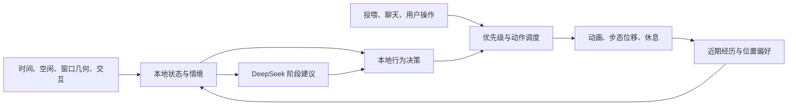

<!-- BEGIN SO1 INTRO -->
## Hi，我是守一 👋

**个人开发者 / DIY 爱好者**

喜欢折腾无人机、桌宠、智能体和各种小玩意儿<br />
把踩过的坑整理出来，分享**普通人也能做出来的硬核 DIY** ✨

---

### 👋 关于我

我是一个喜欢 DIY 的个人开发者。比起只做「能跑起来的 Demo」，我更想做「**能摸得到、能玩起来**」的东西：无人机飞起来、桌宠动起来、智能体接上现实世界，然后把这些过程完整地写下来、拍下来，分享给同样想动手的人。

我的内容主要围绕：

| 方向 | 我在折腾什么 |
| :--- | :--- |
| 🛩️ **DIY 无人机** | 飞控、机架、图传、续航 —— 从零攒一台能飞的 |
| 🤖 **桌宠 / 机器人** | 屏幕桌面宠物、舵机小机器人，软硬件一起调 |
| 🧠 **智能体（Agent）** | 大模型应用、语音交互，让智能体真正「有手有脚」 |
| 🔌 **IoT / 嵌入式** | 单片机、传感器、无线通信，把设备连起来 |

> 💡 我的原则：**硬核，但不高冷**。尽量把原理讲清楚、把步骤拆细，让第一次动手的人也能做出来。

---

### 📺 找到我

| 平台 | 账号 |
| :--- | :--- |
| 📺 哔哩哔哩 | [守一工作室](https://space.bilibili.com/8676747) · UID `8676747` |
| 📱 抖音 | @守一 · 抖音号 `56732943701` |
| 📕 小红书 | 守一 · 小红书号 `94235311118` |
| 💬 QQ 技术交流群 | 守一 DIY 爱好者交流群 · 群号 `672632842` |

> 视频教程、DIY 过程和翻车日常都会同步更新，欢迎来玩；技术问题优先在 QQ 群里问，回复最快。
<!-- END SO1 INTRO -->

---

# so1_dafeiyu · 大肥鱼桌面伙伴


为 Windows 上的 [dsh-pet](https://github.com/PC2005-cloud/dsh-pet) 增加文件收纳和自主生活，让大肥鱼能帮你收好资料，也能在无人互动时拥有自己的活动节奏。

组件版本 **0.17.0**；已在 **dsh-pet 0.4.7 / 0.4.9** 上验证接入。本项目需要先安装上游 dsh-pet，不是独立桌宠应用。

[安装与完整使用说明](so1_dafeiyu_inbox/README.md) · [源码](so1_dafeiyu_inbox/component) · [测试](so1_dafeiyu_inbox/tests) · [代码许可](so1_dafeiyu_inbox/LICENSE)

## 现在能做什么

| 功能 | 使用体验 |
| --- | --- |
| 文件投喂 | 拖入单个或多个文件，大肥鱼张嘴吞下，分析用途后收进“大肥鱼仓库” |
| DeepSeek 辅助分类 | 结合可提取文本、候选目录和历史案例，生成简短用途说明并分类；失败时回退本地规则 |
| 送件演出 | 施法打开文件夹，按视频步态移动、投放，停留后施法关窗，返回原位等夸 |
| 文件管理 | 双击打开仓库，浏览、搜索、预览、定位文件；拖拽调整归属并记录纠正 |
| 自主生活 | 根据时间、空闲和内部状态，观察、伸展、自娱、短距离散步、休息或打盹 |
| DeepSeek 阶段规划 | 根据状态与近期经历安排接下来几分钟的活动，由本地调度器校验并执行 |
| 生活面板 | 查看活动、阶段打算、实际模型、回退原因与近期经历，切换安静陪伴或关闭规划 |
| 状态恢复 | 保存生活状态和用户放置位置，重启后恢复；离线期间不补播任务 |

## 开始使用

1. 在 dsh 的 **desktop 配置**中安装 dsh-pet，确认桌宠正常显示。
2. 安装 **Python 3.10+**。下载本仓库 ZIP 或克隆仓库，进入 `so1_dafeiyu_inbox` 目录。
3. 退出 dsh 和桌宠，在 PowerShell 运行：

```powershell
$petPath = Join-Path $env:USERPROFILE ".dsh\profiles\desktop\node_modules\dsh-pet"
Test-Path $petPath
python .\install.py "$petPath"
```

4. **重新启动 dsh 应用本身**，让宿主路由与桌宠组件一起加载。
5. 先投喂一份测试文件，双击桌宠确认实际位置。仓库顶部的 **大肥鱼的生活** 可查看生活与规划状态。

自定义安装位置可直接作为安装器参数。PDF 文本提取可选安装 `python -m pip install pypdf`；基础文本和常见 Office 文本读取使用标准库。安装器适配包含 `runtime/electron-helper` 的已解包插件目录。

**收纳会真实移动文件。** 当前只处理用户主动投放的文件，不扫描或整理整个桌面。默认资料库位于 Windows“文档”下的“大肥鱼仓库”，已有自定义位置优先保留。

## 与 dsh、dsh-pet、DeepSeek 配合

- **dsh** 提供模型服务与配置，API Key 无需在本组件重复填写。
- **dsh-pet** 提供角色素材、桌面窗口、聊天和播放能力；天气与语音等属于上游功能。
- **本项目** 提供文件仓库、自主生活、阶段规划和送件编排，安装时接入宿主与桌面 helper。

| 模型用途 | 选择方式 |
| --- | --- |
| 文件分类 | 使用宿主当前默认模型；提供商或模型名称需包含 DeepSeek，否则使用本地规则 |
| 生活规划 | 优先使用默认 DeepSeek；默认模型不是 DeepSeek 时，从已配置的 DeepSeek 提供商中选文本模型，不改聊天设置 |

规划失败时继续本地活动。**安静陪伴**暂停自主散步等活动；**关闭自主生活**会恢复上游原有随机动作。

## 自主生活怎样工作



模型每次建议两到四段活动，到活动边界才接入，等待时原活动继续。用户任务优先，过晚或情境已变化的计划会被丢弃。动作可用性、时长、冷却、散步条件与身体占用由本地程序检查。

正常规划间隔至少五分钟；同一运行周期所有宠物合计每小时最多六次调用。失败采用退避，重启不积压补发。阶段规划是行为模拟，不代表角色具有主观意识。

## 数据与隐私

| 数据 | 用途 |
| --- | --- |
| 用户投放的文件 | 本地仓库保存；可提取正文样本及相关案例可能发送给 DeepSeek 用于分类 |
| 文件索引与纠正记录 | 本地 SQLite 保存，用于查找、调整及后续分类参考 |
| 生活状态与经历 | 保存在 Electron userData 的 `file-inbox/life-state.json`，与文件索引分开 |
| 生活规划输入 | 仅发送时段、空闲、简要状态、允许活动和最近八条经历；不发送文件正文、文件名、窗口标题或截图 |

环境感知读取时间、系统空闲、锁屏/休眠与前台窗口几何，不持续截屏或读取其它应用正文。生活面板支持关闭 DeepSeek 规划。

## 升级与卸载

下载新代码，退出 dsh 后再次运行安装器，再启动 dsh。升级上游 dsh-pet 会覆盖组件接入点和自定义素材，需要重新运行本组件安装器。

```powershell
python .\install.py "$petPath" --uninstall
```

卸载保留个人仓库、数据库和额外动作素材。安装器支持解析 Windows junction 的真实插件目录，普通安装无需设置版本隔离目录。

当前依赖上游内部接入点，其它版本需核对兼容性。吞件后的衔接受模型、开窗与定位耗时影响；混合 DPI 多屏及持续移动目标窗口等场景尚未全部验收。窗口攀爬、自动绕行和长期个性学习仍是后续方向。

## 开发与验证

组件源码位于 [`so1_dafeiyu_inbox`](so1_dafeiyu_inbox)，关键状态、占用令牌、视频同步与模型回退逻辑配有注释。模块职责见[开发结构](so1_dafeiyu_inbox/README.md#开发结构)。

```powershell
cd so1_dafeiyu_inbox
python tests/test_worker.py
python tests/test_catalog.py
python tests/test_filing.py
node tests/test_magic.cjs
node tests/test_magic_flow.cjs
node tests/test_life.cjs
node tests/test_life_planner.cjs
```

自动测试覆盖归档、同名与撤销冲突、分类纠正、八小时虚拟生活节奏、任务优先级、步行取消、计划校验、限流、超时与过期响应。另已在本机验证真实视频、文件归档及 DeepSeek 调用；虚拟时间测试不等同于真实连续运行八小时。

代码采用 MIT 许可；角色及动作素材的使用范围见[素材说明](so1_dafeiyu_inbox/README.md#许可与素材)，代码许可不自动授予全部素材的独立授权。
